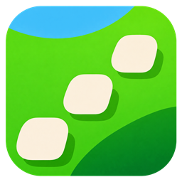

<p align="center"></p>

# Madang (마당)

**바탕화면 아이콘이 풍경의 일부가 되는 Windows 라이브 배경화면.**

Madang은 바탕화면을 하나의 마당처럼 만듭니다. 아이콘을 옮기거나 추가·삭제하면 해변, 초원, 구름과 그림자가 아이콘 주위로 실시간으로 다시 자리를 잡습니다. 모든 계산은 PC 안에서 이뤄지고, AI·계정·API 키가 필요 없습니다.

**한국어** · [English](#english)

> Madang은 [Deskland Preview](https://github.com/BLEZZ0102/Deskland)(GPL-3.0)를 바탕으로 한 **독립 프로젝트**입니다. Deskland 원작자와 관계가 없으며 승인이나 보증을 받지 않았습니다. 자세한 내용은 [NOTICE](NOTICE)와 [TRADEMARKS.md](TRADEMARKS.md)를 보세요.


## 포함된 테마

| 별자리 | 해변 | 초원 |
| --- | --- | --- |
|  |  |  |
| 아이콘이 별이 되고 가까운 별끼리 별자리로 이어지는 밤하늘. 은하수, 별똥별, 아이콘이 적은 쪽 하늘에 뜨는 초승달, 능선 위 불 켜진 한옥. Madang 자체 테마. | 청록빛 파도, 카약, 바닷새와 야자수. | 흘러가는 구름과 그림자, 연 날리는 아이와 작은 검은 고양이. |

## 앞으로 할 일

- 새 테마 (원작의 유료 테마를 재현하지 않는 자체 컨셉)

## 기능

- **아이콘 적응형 풍경:** 실제 바탕화면 아이콘 위치를 읽어, 아이콘이 움직이면 풍경이 부드럽게 바뀝니다.
- **바탕화면 상주용 설계:** 트레이 메뉴, 로그인 시 자동 시작, 창을 최대화하거나 전체 화면이면 자동 일시정지.
- **멀티 모니터:** 모니터마다 그 모니터의 아이콘에 맞춘 풍경을 따로 그립니다. 모니터마다 풍경이 다르고, 최대화된 창이 있는 모니터만 멈춥니다. 트레이 메뉴의 "모든 모니터에 표시"를 끄면 주 모니터에만 그립니다.
- **개인정보를 지키는 공유:** 이미지·애니메이션 공유는 예시 아이콘과 색 블록만 쓰고, 실제 바탕화면이나 파일 이름은 찍지 않습니다.
- **한국어 화면:** 한국어, 영어, 간체 중국어를 지원하고 기본값은 Windows 표시 언어를 따릅니다.
- **독립 설치:** 설치 폴더, 설정, 시작 프로그램 항목, 실행 인스턴스가 Deskland와 분리되어 있어 함께 설치해도 충돌하지 않습니다.

## 요구 사항

- Windows 10 또는 Windows 11, 64비트
- Microsoft Edge WebView2 Runtime
- Windows에 포함된 PowerShell과 .NET Framework C# 컴파일러 (.NET SDK 설치 불필요)
- 첫 빌드 때 WebView2 개발 라이브러리를 내려받기 위한 인터넷 연결
- 브라우저 미리보기를 쓸 때만 Node.js

내장 그래픽에서 모니터당 30fps를 목표로 합니다. 모니터가 많을수록 그래픽 부하도 늘어납니다.

## 소스에서 빌드

저장소 루트에서 PowerShell을 엽니다.

```powershell
powershell -ExecutionPolicy Bypass -File host\build.ps1
host\bin\Madang.exe
```

`host/`와 `prototype/`의 상대 위치를 유지해야 합니다. 빌드 결과는 `host/bin/`에 생깁니다.

프로그램을 다시 실행하거나 트레이 아이콘을 더블클릭하면 설정이 열립니다. 종료하고 원래 Windows 배경화면으로 돌리려면 트레이 메뉴를 쓰거나 다음을 실행합니다.

```powershell
host\bin\Madang.exe --exit
```

설정과 로그는 `%LOCALAPPDATA%\Madang`에 저장됩니다.

## 브라우저 미리보기

```powershell
node prototype\serve.mjs
```

**http://localhost:5178/settings.html** 을 엽니다. 브라우저에서는 예시 아이콘을 쓰며, 실제 바탕화면 아이콘에 맞추려면 Windows 호스트가 필요합니다.

## Windows 설치 파일

```powershell
powershell -ExecutionPolicy Bypass -File tools\build-installer.ps1
```

첫 빌드 때 포터블 NSIS와 Microsoft WebView2 부트스트래퍼를 내려받습니다. 결과물은 SHA256 체크섬, 대응 소스 ZIP과 함께 `dist/`에 생깁니다. 설치 위치는 현재 사용자의 `Programs\Madang`이며 관리자 권한이 필요 없습니다.

아직 공개 릴리스는 없습니다.

## 폴더 구조

| 경로 | 내용 |
| --- | --- |
| `host/` | Windows 호스트, 빌드 스크립트, 앱 매니페스트, 아이콘 |
| `prototype/flat.html` | 해변 테마 |
| `prototype/meadow.html` | 초원 테마 |
| `prototype/starry.html` | 별자리 테마 |
| `prototype/settings.html` | 설정 화면 |
| `prototype/themes.json` | 테마 정의와 기본값 |
| `prototype/i18n/` | 화면 문구 (한국어, 영어, 간체 중국어) |
| `prototype/share.js` | 개인정보를 지키는 이미지·애니메이션 공유 |
| `prototype/assets/` | 테마 이미지 |
| `tools/` | 설치 파일 빌드 도구 |

## 알려진 제한

- 모니터마다 배율(DPI)이 다르면 보조 모니터의 풍경 크기가 주 모니터 배율을 따를 수 있습니다(같은 배율 모니터 3대로만 확인했습니다).
- 설정 창의 미리보기와 공유 이미지·영상은 주 모니터 화면 기준입니다.
- Windows 추천(Spotlight)이나 배경화면 슬라이드 쇼를 쓰면 Windows가 이미지를 바꿀 때 잠깐 깜박일 수 있습니다.

## 라이선스와 출처

소스 코드와 포함된 테마 소재는 [GPL-3.0](LICENSE)으로 배포됩니다. 원작 Deskland Preview의 저작권 고지는 [NOTICE](NOTICE)에 그대로 유지합니다. 서드파티 의존성은 [THIRD_PARTY_NOTICES.md](THIRD_PARTY_NOTICES.md)에 있습니다.

---

## English

**A living Windows wallpaper that makes your desktop icons part of the scenery.**

Madang ("courtyard" in Korean) turns the space around your icons into a living landscape. Move, add or remove an icon and the beach, meadow, clouds and shadows reshape around it in real time — locally, without AI, an account or an API key.

> Madang is an **independent project** based on [Deskland Preview](https://github.com/BLEZZ0102/Deskland) (GPL-3.0). It is not affiliated with, approved or endorsed by the Deskland authors. See [NOTICE](NOTICE) and [TRADEMARKS.md](TRADEMARKS.md).

- **Themes:** Constellations (Madang's own night sky, where your icons become stars), Beach and Meadow, with every setting saved between sessions.
- **Languages:** Korean, English and Simplified Chinese, following the Windows display language by default.
- **Multiple monitors:** every monitor gets its own scene shaped around its own icons; turn off "Show on all monitors" in the tray menu to use the primary monitor only.
- **Planned:** more original themes.
- **Requirements:** 64-bit Windows 10/11 and the Microsoft Edge WebView2 Runtime. Building uses the C# compiler bundled with Windows.

```powershell
powershell -ExecutionPolicy Bypass -File host\build.ps1
host\bin\Madang.exe
```

Settings and logs live in `%LOCALAPPDATA%\Madang`. Browser preview: `node prototype\serve.mjs`, then open http://localhost:5178/settings.html. Installer: `tools\build-installer.ps1` (no public release yet).

Source code and bundled theme assets are released under [GPL-3.0](LICENSE).
